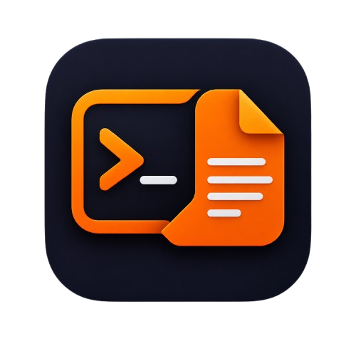

# CliDoc



CliDoc é uma ferramenta de linha de comando open source para automatizar a geração de documentação de APIs a partir da análise estática de comentários e código-fonte.

Status: beta 1 disponível — a primeira build pública já foi publicada para testes iniciais e feedback da comunidade.

## Visão geral

O objetivo do CliDoc é eliminar a manutenção manual de documentação de endpoints, permitindo que desenvolvedores descrevam rotas diretamente no código, de forma declarativa e agnóstica a linguagem.

A ferramenta extrai metadados de comentários e estruturas do código, converte esses dados em uma representação intermediária (IR) e gera documentação em formatos amplamente utilizados, como OpenAPI 3.0 e Markdown.

## O que o CliDoc oferece

- Extração automática de informações de rotas, parâmetros e respostas
- Suporte a geração de documentação OpenAPI 3.0
- Exportação para Markdown
- Estrutura modular para suporte a múltiplas linguagens
- Preview local da documentação com visualização interativa
- Fluxo baseado em pipeline de transformação, facilitando extensão futura

## Arquitetura

O projeto foi pensado em torno de um pipeline de processamento desacoplado:

```text
Código-fonte
   ↓
Parsers / extração de metadados
   ↓
Representação intermediária (IR)
   ↓
Generators
   ↓
OpenAPI / Markdown / Preview
```

### Módulos previstos

- Core CLI Engine: gerenciamento dos comandos e configuração
- Parser Interface: contrato para extração em diferentes linguagens
- Intermediate Representation (IR): estrutura comum para rotas e respostas
- Generators: conversão para OpenAPI e Markdown
- Preview Server: visualização local da documentação

## Formato de anotações

Os comentários do código podem seguir uma convenção declarativa com anotações como as abaixo:

```go
// @Route POST /api/v1/users
// @Summary Criar Usuário
// @Description Cadastra um novo usuário
// @Tag Usuários
// @Param id path string true "ID do usuário"
// @Success 201 json "Criado com sucesso"
// @Failure 400 json "Dados inválidos"
```

### Anotações suportadas

| Anotação | Descrição |
| :--- | :--- |
| `@Route` | Define o método HTTP e o caminho da rota |
| `@Summary` | Resumo da rota |
| `@Description` | Descrição detalhada |
| `@Tag` | Agrupamento da rota |
| `@Param` | Parâmetro da rota, query, header ou body |
| `@Success` | Resposta de sucesso |
| `@Failure` | Resposta de erro |

## Exemplo de estrutura de representação intermediária

```go
package ir

type API struct {
    Title     string  `json:"title"`
    Version   string  `json:"version"`
    BaseURL   string  `json:"base_url"`
    Endpoints []Route `json:"endpoints"`
}

type Route struct {
    Method      string      `json:"method"`
    Path        string      `json:"path"`
    Summary     string      `json:"summary"`
    Description string      `json:"description"`
    Tag         string      `json:"tag"`
    Params      []Parameter `json:"params"`
    Responses   []Response  `json:"responses"`
}
```

## Roadmap

- [x] MVP inicial com parser Go básico e geração de OpenAPI 3.0 JSON
- [x] Suporte a exportação em Markdown
- [ ] Comando de preview local da documentação
- [ ] Leitura automática de schemas e DTOs
- [ ] Suporte a Python e TypeScript/Node.js

## Status da implementação

O projeto está em fase inicial de desenvolvimento. A base da arquitetura e o modelo de anotações já foram definidos, e a primeira release será focada em entregar a geração de documentação de forma simples, automatizada e extensível.

## Como usar

O projeto já inclui a CLI inicial em Go. O fluxo atual é:

```bash
# inicializa a configuração
clidoc init

# gera a documentação OpenAPI a partir do código
clidoc generate --source . --output docs/openapi.json

# gera a documentação em Markdown
clidoc generate --source . --output docs/api.md --format markdown

# inicia a visualização local em Swagger UI
clidoc serve --port 8080
```

O arquivo `clidoc.yaml` contém a configuração default do projeto:

```yaml
title: "CliDoc API"
version: "1.0.0"
base_url: "http://localhost:8080"
source: "."
output: "docs/openapi.json"
port: 8080
host: "0.0.0.0"
```

A documentação gerada pode ser visualizada em `http://localhost:8080` após iniciar o comando `serve`.
O Swagger UI abre com o tema escuro Terminal Horizon; use o botão no cabeçalho para alternar entre os temas. A escolha fica salva no navegador.

## Ambiente de desenvolvimento

O ambiente de desenvolvimento usa Docker Compose e Go. É necessário ter Docker com o plugin Docker Compose instalado.

Inicie o contêiner de desenvolvimento na raiz do repositório:

```bash
docker compose up -d --build
docker compose exec dev sh
```

O código do repositório fica disponível em `/workspace`. As dependências e o cache de compilação do Go são mantidos em volumes Docker entre reinicializações. A porta `8080` do host é encaminhada para o contêiner para uso futuro pelo servidor de preview.

Para parar o ambiente:

```bash
docker compose down
```

## Releases e executáveis

A versão beta1 do CliDoc já foi publicada no GitHub Releases e está disponível para download e testes iniciais.

As releases são geradas pelo GitHub Actions quando uma tag no formato `v*` é enviada ao repositório. Para publicar uma nova versão:

```bash
git tag v1.0.0-beta.1
git push origin v1.0.0-beta.1
```

Os assets da release incluem arquivos ZIP com o executável para Windows e arquivos TAR.GZ para Linux e macOS (Intel e Apple Silicon). Também é publicado um pacote RPM para Linux.

A arquitetura do pacote RPM deve corresponder à do computador. Confira-a com `uname -m`: em sistemas `x86_64`, baixe o RPM `linux_amd64`; em sistemas `aarch64`, baixe o RPM `linux_arm64`. Por exemplo, o pacote `clidoc_0.1.0-beta.1_linux_arm64.rpm` não pode ser instalado em um sistema `x86_64`.

A beta1 inclui a CLI inicial, geração de documentação OpenAPI 3.0 e suporte básico para exportação em Markdown, sendo indicada para avaliação funcional e coleta de feedback da comunidade.

## Contribuição

Contribuições são bem-vindas. O projeto ainda está em desenvolvimento e a estrutura da base pode evoluir conforme a primeira release for amadurecida.

## Licença

O projeto é licenciado sob a Apache License 2.0 — veja [LICENSE.md](LICENSE.md).
